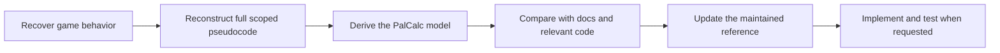

# Researching Palworld breeding mechanics

PalCalc needs a reliable understanding of the game rules behind breeding paths and
their success probabilities. An AI agent can use
[Reverse Engineer Anything (REA)](https://github.com/morluto/rea) to investigate a
specific Palworld executable and compare its behavior with PalCalc.

For the current rules, approximations, and assessment coverage, read
[PALWORLD-BREEDING-MECHANICS.md](../../../PALWORLD-BREEDING-MECHANICS.md).
This folder explains how to investigate, review, and maintain that understanding.

## Choose a starting point

| Task | Start here |
| --- | --- |
| Check the reasoning or reproduce checks behind a committed finding | [Review existing findings](#review-existing-findings) |
| Investigate a new or not-yet-covered mechanic | [Run an assessment](#run-an-assessment-yourself), using the requested scope |
| Check for changes after a game update | [Check a game update](#check-a-game-update) |
| Read detailed game pseudocode | Open **Evidence / pseudocode** in the [published assessments](#published-assessments) |
| Understand which document to update | [Where information lives](#where-information-lives) and [when to update it](#when-updating-these-docs) |

## Data and logic

[GenDB](../../../PalCalc.GenDB/README.md) tells us what values are stored in the
game files, such as species stats, breeding ranks, recipes, skill weights, and
icons. Reverse engineering tells us how the game uses those values: what it
selects, filters, calculates, and saves.

We need both. Finding the expected weights doesn't prove how they're selected,
and understanding the selection code doesn't prove which values the current
assets contain. We also need to check that PalCalc considers the same eligible
Pals and recipes as the game.

## Questions PalCalc needs answered

| Area | Questions |
| --- | --- |
| Child species | Which recipe or rank rule chooses the child, including genders, eligibility, ties, and later replacements? |
| Child gender | How is the child's gender selected, and which data or overrides influence it? |
| Child passives | How are parental and random passives selected, including item overrides and failed additions? |
| Child attacks | How are equipped, inherited, natural, and mastered attacks assembled? |
| Child IVs | How are parental and fresh values selected, including asymmetric branches and relevant overrides? |
| Wild-Pal passives | What is assigned at spawn, what is guaranteed, and what can change on capture? |
| Wild-Pal attacks | What is assigned at spawn, learned with level, or changed on capture? |
| Wild-Pal gender | How is gender selected when a wild Pal is spawned? |

These are the questions a complete review needs to cover; they haven't all been
answered yet. The [coverage table](../../../PALWORLD-BREEDING-MECHANICS.md#assessment-coverage)
shows the published findings and remaining gaps. A smaller review can focus on
selected questions, but should say which modes it covers: ordinary breeding,
items, mutation, spawning, or capture.

## From game behavior to PalCalc



The full model describes the part of the game being investigated, including
details PalCalc doesn't model. The reduced model describes the rules we use for
PalCalc and explains what we leave out. For example, we might ignore which random
passive is selected while still accounting for how many are added. If selections
can fail, ignoring those failures is an approximation that needs to be stated.

The [workflow](ASSESSMENT-WORKFLOW.md) explains what to produce at each stage.
The [REA guide](REA-GUIDE.md) explains how to investigate the executable.
The [review skill](palworld-breeding-review/SKILL.md) compares findings from a
completed investigation. It doesn't start another investigation or authorize
implementation changes.

## Review existing findings

Start with the relevant [published assessment](#published-assessments). Its
`assessment.md` states the conclusions, reviewed code/document baseline, and checks
performed. Follow its links into `evidence.md` for the game pseudocode and the
observations supporting each claim.

1. Check the report's build, executable identity, input-data sources, and scope.
   A conclusion about ordinary breeding doesn't automatically cover mutation,
   spawning, or capture.
2. Check the reasoning against the cited evidence. Use the repository's
   [review skill](palworld-breeding-review/SKILL.md) and its
   [notes](palworld-breeding-review/references/review-notes.md) for a structured
   comparison. An older installed copy may cover fewer mechanics.
3. If reproducing a check, use the report's recorded inputs and assumptions and
   identify what the check establishes. Synthetic checks test the reconstructed
   calculation; PalCalc tests check the implementation. Neither runs the game or
   independently verifies the recovered instructions. The report's conclusions
   apply to its named baseline; newer code needs its own comparison.

Reviewing the published evidence doesn't require a new Ghidra session or access
to the original chat and ignored working files. If independent executable
inspection is needed, treat it as an explicitly scoped investigation using the
[workflow](ASSESSMENT-WORKFLOW.md), and distinguish its new observations from the
retained evidence. Don't silently turn an evidence review into another REA run.

## Run an assessment yourself

Use the [assessment workflow](ASSESSMENT-WORKFLOW.md) for a new mechanic or a gap
in an earlier investigation. Select the relevant questions from the table above;
a targeted task doesn't require examining every breeding system.

You'll need the game files, a writable checkout, and an AI environment with REA's
native-analysis tools and a compatible Ghidra/Java installation. The
[setup instructions](REA-GUIDE.md#ghidra-prerequisite-gate) explain how to check
those tools and reuse an existing installation with the required authorization.
GenDB and mapping prerequisites are only needed if the investigation requires
asset extraction.

1. Make the game files and checkout available, then check the required tools
   using the setup instructions above.
2. Give the agent the executable or installed-game path, desired scope, and the
   mechanics document/code revision to compare. Follow the
   [assessment workflow](ASSESSMENT-WORKFLOW.md). Unknown version metadata should
   be recorded as unknown, not inferred from an older report.
3. Review `evidence.md` and `assessment.md`. They should be understandable without
   the original chat, native session, or ignored working directory.

For example, from a checkout with the required tools available:

```text
Follow docres/research/palworld-breeding/ASSESSMENT-WORKFLOW.md to assess the
installed Palworld build. Examine how a bred child's gender is selected,
including any relevant item overrides. Compare with
PALWORLD-BREEDING-MECHANICS.md at the current revision. Report any scope gaps.
Publish the evidence and assessment; do not implement changes in this run.
```

## Check a game update

Follow [Reviewing a later game build](ASSESSMENT-WORKFLOW.md#reviewing-a-later-game-build).
Use the relevant earlier assessment as a baseline, recheck the executable identity
and asset dependencies, and record which behaviors changed, remained equivalent,
were carried forward, or weren't assessed. An unchanged executable doesn't prove
unchanged game data, and different code addresses don't prove a behavior change.

The workflow defines the comparison and publication procedure. Publish new
build-specific findings separately, then update the maintained reference and
coverage when those updates are part of the task. Don't rewrite an older report
as though it investigated the new build.

## Where information lives

| Location | Main responsibility |
| --- | --- |
| [Current mechanics](../../../PALWORLD-BREEDING-MECHANICS.md) | Maintained explanation of game rules and current verification coverage, derived from the linked findings |
| [Limitations](../../../LIMITATIONS.md) | Current modeling omissions, search tradeoffs, and their practical effects; detailed mechanics and build coverage stay in the mechanics reference |
| [Solver overview](../../../PalCalc.Solver/README.md) | How the current implementation searches, estimates effort, and finalizes results |
| [Workflow](ASSESSMENT-WORKFLOW.md) | Investigation, reconstruction, comparison, publication, and update process |
| [REA guide](REA-GUIDE.md) | Setup, tracing checklists, technical methods and troubleshooting |
| [Report template](ASSESSMENT-TEMPLATE.md) | Outlines for the two published assessment files |
| `assessments/<date>-build-<id>/evidence.md` | Build-specific game model and pseudocode, selected supporting observations, and evidence boundaries |
| `assessments/<date>-build-<id>/assessment.md` | Interpretation of that evidence and comparison with an explicitly recorded PalCalc baseline, including consequences and checks |
| `tools/` | Reusable helpers and their tests; see the [PE helper instructions](REA-GUIDE.md#bundled-offline-pe-helper) |
| `_REA-ANALYSIS/runs/<timestamp>-<id>/` at the repo root | Ignored raw responses, experiments, exports, logs and working notes |

The evidence files support the game-behavior claims. The assessment files explain
their consequences for the reviewed PalCalc baseline. The maintained mechanics
reference summarizes accepted findings for readers; the solver overview describes
the implementation. Check current implementation claims against the code rather
than assuming a historical assessment still describes it.

## When updating these docs

- Accepted research findings prompt a review of the mechanics explanation,
  coverage table, and relevant limitations. Link each summary to the detailed
  finding it is based on; keep unknowns and data assumptions visible.
- Implementation changes prompt a review of the solver explanation, worked
  calculations, and current limitations. Record the change without making older
  assessments appear to describe the new implementation.
- A new build assessment updates the [assessment index](#published-assessments)
  and, when reference updates are included, the mechanics coverage. Preserve
  older reports' build identities, baselines, and scope.
- Short explanations may repeat information for their audience, but should link
  to the document responsible for the detailed rule or procedure. Review those
  summaries when the underlying explanation changes; don't maintain competing
  coverage tables or copies of the full workflow.

## Additional game logic

REA can investigate a scoped game calculation outside inheritance using the same
process. [Additional game logic](../palworld-misc/README.md) documents world-map
coordinate conversion and links the supporting
[egg-production-time model](../../../PALWORLD-BREEDING-MECHANICS.md#egg-production-time).
These topics receive targeted reviews when relevant. A standard breeding review
records whether each needs work, is carried forward, or was not assessed; it does
not require both investigations on every run.

## Published assessments

| Date | Build | Scope | Assessment / comparison | Evidence / pseudocode |
| --- | --- | --- | --- | --- |
| 2026-10-18 | 25246127 | Offspring species selection | [Assessment](assessments/2026-10-18-build-25246127/assessment.md) | [Evidence](assessments/2026-10-18-build-25246127/evidence.md#reconstructed-ordinary-selector) |
| 2026-10-16 | 25246127 | IVs, passives, and attack inheritance | [Assessment](assessments/2026-10-16-build-25246127/assessment.md) | [Evidence](assessments/2026-10-16-build-25246127/evidence.md) |

For another build, start from the workflow and semantic discovery anchors. Earlier
addresses and findings are leads, not proof of unchanged behavior.
