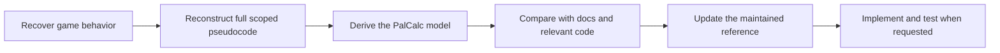

# Researching Palworld breeding mechanics

PalCalc needs a reliable understanding of the game rules behind breeding paths and
their success probabilities. AI agents use [Reverse Engineer Anything (REA)](https://github.com/morluto/rea)
to recover behavior from a specific Palworld executable and compare it with PalCalc.

For the current rules, approximations, and assessment coverage, read
[PALWORLD-BREEDING-MECHANICS.md](../../../PALWORLD-BREEDING-MECHANICS.md).
This folder explains how to investigate, review, and maintain that understanding.

## Data and logic

[GenDB](../../../PalCalc.GenDB/README.md) extracts data such as species stats,
breeding ranks, recipes, skill weights, and icons. Reverse engineering establishes
how game code uses those inputs: selection, ordering, filtering, arithmetic, and
final saved values. Matching executable logic alone does not verify current asset
values or that PalCalc's generated breeding graph uses an equivalent roster.

## Questions PalCalc needs answered

| Area | Questions |
| --- | --- |
| Child species | Which recipe or rank rule chooses the child, including genders, eligibility, ties, and later replacements? |
| Child gender | How is the child's gender selected, and which data or overrides influence it? |
| Child passives | How are parental and random passives selected, including item overrides and failed additions? |
| Child attacks | How are equipped, inherited, natural, and mastered attacks assembled? |
| Child IVs | How are parental and fresh values selected, including asymmetric branches and relevant overrides? |
| Wild-Pal passives | What is assigned at spawn, what is guaranteed, and what can change on capture? |
| Wild-Pal attacks | What is assigned at spawn, learned with level, or changed on capture? |
| Wild-Pal gender | How is gender selected when a wild Pal is spawned? |

These are the coverage requirements, not a claim that every question is already
answered. The [coverage table](../../../PALWORLD-BREEDING-MECHANICS.md#assessment-coverage)
identifies published findings and gaps. Ordinary, item, mutation, spawn, and capture
modes must be distinguished; a scoped review can leave other modes unassessed.

## From game behavior to PalCalc



The full model describes the scoped game process, including details PalCalc does
not model. The reduced model explains what PalCalc needs and why other details
are omitted. For example, it can ignore which random passive is selected while
still accounting for the number of random additions. Failed filling attempts may
affect that count and must be identified as an approximation if omitted.

The [workflow](ASSESSMENT-WORKFLOW.md) owns stage boundaries and output rules.
The [REA guide](REA-GUIDE.md) supplies the technical extraction instructions.
The [review skill](palworld-breeding-review/SKILL.md) compares completed evidence;
it does not start another native investigation or authorize implementation.

## Run an assessment yourself

1. Have the game files and a writable checkout available. Use an AI environment
   with REA native-analysis tools and a compatible Ghidra/Java installation.
   Follow the [prerequisite gate](REA-GUIDE.md#ghidra-prerequisite-gate) rather than
   installing another copy of working tools. GenDB and mapping prerequisites are
   needed only when the scoped investigation requires asset extraction.
2. Give the agent the executable or installed-game path, desired scope, and the
   mechanics document/code revision to compare. Follow the
   [assessment workflow](ASSESSMENT-WORKFLOW.md). Unknown version metadata should
   be recorded as unknown, not inferred from an older report.
3. Review `evidence.md` and `assessment.md`. They should be understandable without
   the original chat, native session, or ignored working directory.

For example, from a checkout with the required tools available:

```text
Follow docres/research/palworld-breeding/ASSESSMENT-WORKFLOW.md to assess the
installed Palworld build. Examine child species, gender, passives, attacks,
and IVs, plus wild-Pal initialization and capture effects. Compare with
PALWORLD-BREEDING-MECHANICS.md at the current revision. Report any scope gaps.
Publish the evidence and assessment; do not implement changes in this run.
```

To review existing findings without starting REA, supply the relevant assessment
folder to [palworld-breeding-review](palworld-breeding-review/SKILL.md). Use this
repository copy of the skill and its notes; an older installed copy may have a
narrower scope.

## Where information lives

| Location | Purpose |
| --- | --- |
| [Current mechanics](../../../PALWORLD-BREEDING-MECHANICS.md) | Maintained rules, PalCalc approximations, coverage and supporting calculations |
| [Workflow](ASSESSMENT-WORKFLOW.md) | Investigation, reconstruction, comparison, publication, and update process |
| [REA guide](REA-GUIDE.md) | Setup, tracing checklists, technical methods and troubleshooting |
| [Report template](ASSESSMENT-TEMPLATE.md) | Outlines for the two published assessment files |
| `assessments/<date>-build-<id>/evidence.md` | Recovered scoped game model and selected supporting evidence |
| `assessments/<date>-build-<id>/assessment.md` | PalCalc projection, baseline comparison, consequences, and checks |
| `tools/` | Reusable helpers and their tests; see the [PE helper instructions](REA-GUIDE.md#bundled-offline-pe-helper) |
| `_REA-ANALYSIS/runs/<timestamp>-<id>/` at the repo root | Ignored raw responses, experiments, exports, logs and working notes |

## Additional game logic

REA can investigate a scoped game calculation outside inheritance using the same
process. [Additional game logic](../palworld-misc/README.md) documents world-map
coordinate conversion and links the supporting
[egg-production-time model](../../../PALWORLD-BREEDING-MECHANICS.md#egg-production-time).
These topics receive targeted reviews when relevant. A standard breeding review
records whether each needs work, is carried forward, or was not assessed; it does
not require both investigations on every run.

## Published assessments

| Date | Build | Scope |
| --- | --- | --- |
| 2026-10-18 | 25246127 | [Offspring species selection and comparison](assessments/2026-10-18-build-25246127/assessment.md) |
| 2026-10-16 | 25246127 | [IVs, passives, and attack inheritance](assessments/2026-10-16-build-25246127/assessment.md) |

For another build, start from the workflow and semantic discovery anchors. Earlier
addresses and findings are leads, not proof of unchanged behavior.
